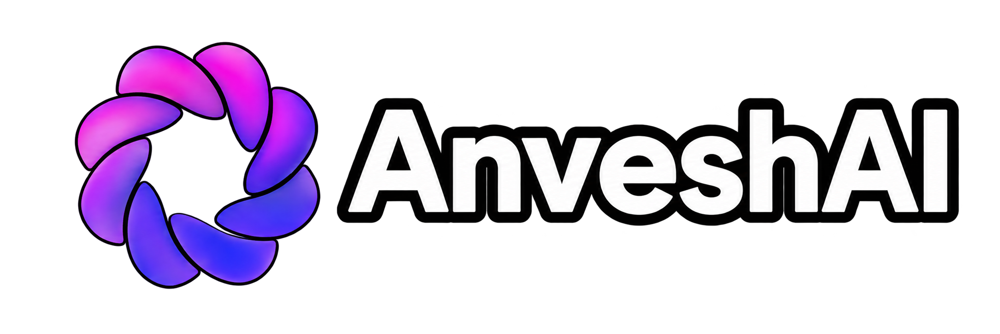

<div align="center">
  <picture>
    
  </picture>
</div>
<hr>
<div align="center" style="line-height: 1;">
  <a href="https://huggingface.co/AnveshAI" target="_blank"></a>
  <a href="https://www.apache.org/licenses/LICENSE-2.0" target="_blank"></a>
</div>
<div align="center" style="line-height: 1;">
  <a href="#"></a>
  
  
  
  
  
</div>

**CoderLM** is a compact 100.2M-parameter language model purpose-built for multi-language code generation across **13 programming and markup languages** — Python, Java, JavaScript, C++, C, Rust, TypeScript, Go, HTML, CSS, Shell, SQL, and Markdown. Built on the custom **AnvArc** (AnveshAI Architecture) — a 15-layer hybrid architecture combining **10× ParallelMinGRU** linear recurrence and **5× Differential Grouped-Query Attention (DifferentialGQA)** — CoderLM delivers high-efficiency code generation and fill-in-the-middle infilling with an expanded **2,048-token context window**.

**Small enough to run on any device — including edge devices like smartphones, tablets, Raspberry Pi, and other embedded hardware.** At just ~191MB (FP16), CoderLM brings multi-language code generation to devices where larger models simply can't run. No high-end GPU required — it runs comfortably on CPU or mobile accelerators.

---

## Highlights

- **100.2M parameters** (87.6M non-embedding) — ultra-compact model with tied input/output embeddings
- **~191MB model size** (FP16 `model.safetensors`) — fits easily in RAM on edge devices and consumer hardware
- **AnvArc Hybrid Architecture** — 10× ParallelMinGRU linear recurrent blocks + 5× DifferentialGQA with RoPE
- **4× Extended Context (2,048 tokens)** — trained on full 2K sequences with stable perplexity scaling across all lengths
- **13 languages supported** — Python, Java, JavaScript, C++, C, Rust, TypeScript, Go, HTML, CSS, Shell, SQL, Markdown
- **18.7% Loss Reduction over 10K Baseline** — weighted multi-language loss improved from 1.1637 down to **0.9463** (Perplexity: **2.58**)
- **Isolated-newline 16K BPE tokenizer** — strict indentation and newline preservation (`Split(Regex(r"\n"), behavior="isolated")`)
- **Task & language-oriented special tokens** — routing with `<|lang:xyz|>` tokens and Fill-in-the-Middle (`<|fim_prefix|>`, `<|fim_middle|>`, `<|fim_suffix|>`)

---

## Model Details

| Property | Value |
|----------|-------|
| **Model Name** | AnveshAI CoderLM 0.1B (2K Context) |
| **Parameters** | 100,176,325 (100.2M) |
| **Architecture** | **AnvArc** (15-Layer Hybrid: 10× ParallelMinGRU + 5× DifferentialGQA) |
| **Hidden Size ($d_{model}$)** | 768 |
| **Intermediate Size ($d_{ff}$)** | 1808 (SwiGLU) |
| **Layers** | 15 (10 MinGRU + 5 DifferentialGQA) |
| **Attention Heads** | 8 Query Heads ($d_{head}=64$) |
| **KV Heads** | 2 (Grouped Query Attention, 4:1 ratio) |
| **Vocab Size** | 16,384 (Isolated-Newline BPE) |
| **Max Context** | **2,048 tokens** |
| **Precision** | FP16 (`model.safetensors`) & FP32 |
| **Activation** | SwiGLU (SiLU) |
| **Tied Embeddings** | Yes (`lm_head.weight == tok_emb.weight`) |
| **Training Steps** | 15,000 (WSD Schedule) |
| **2K Val Loss** | **1.1459** (Perplexity: **3.15**) |
| **Top-1 / Top-5 Accuracy** | **76.84%** / **88.35%** |
| **Weighted 13-Lang Loss** | **0.9463** (Perplexity: **2.58**) |
| **Model Size on Disk** | ~191 MB (`model.safetensors`) |

---

## Comparison: New (2K Context, Step 15,000) vs Old (512 Context, Step 10,000)

The table below compares the new **Step 15,000 (2K Context)** release against the previous **Step 10,000 (512 Context)** model across all canonical benchmarks:

### 1. Overall Model Comparison

| Dimension | Old Model (Step 10,000) | New Model (Step 15,000) ★ | Improvement / Delta |
| :--- | :---: | :---: | :---: |
| **Context Window** | 512 tokens | **2,048 tokens** | **4× Context Expansion** |
| **Training Steps** | 10,000 steps | **15,000 steps** | +5,000 steps (WSD Decay) |
| **Architecture** | Hybrid MinGRU+DiffGQA | **AnvArc** (Optimized Boundary Reset) | Architecture refinement |
| **Weighted 13-Lang Loss** | 1.1637 | **0.9463** | **-0.2174 (-18.7% Loss)** ⚡ |
| **Weighted 13-Lang PPL** | 3.20 | **2.58** | **-0.62 (-19.4% PPL)** ⚡ |
| **2K Context Loss** | *N/A (OOM / truncated)* | **1.1459** | Full 2K sequence support |
| **2K Context Perplexity** | *N/A* | **3.15** | Stable long-range modeling |
| **Top-1 Next-Token Accuracy** | 75.54% | **76.84%** | **+1.30% Accuracy** |
| **Logit Scale Factor** | 1.1080 | **1.2861** | Sharper output distribution |
| **Model Size on Disk** | 191.09 MB | **191.09 MB** | Zero parameter overhead |

---

### 2. Per-Language Breakdown Comparison (13 Languages)

| Language | Dataset Weight | Old Step 10K Loss | New Step 15K Loss ★ | Delta (New vs Old) | New Step 15K Top-1 Acc |
| :--- | :---: | :---: | :---: | :---: | :---: |
| **HTML** | 4.0% | 0.9901 | **0.0669** | **-0.9232 (-93.2%)** ⚡ | **98.14%** |
| **C** | 8.0% | 0.7320 | **0.1386** | **-0.5934 (-81.1%)** ⚡ | **97.07%** |
| **JavaScript** | 10.0% | 1.3318 | **0.2738** | **-1.0580 (-79.4%)** ⚡ | **92.97%** |
| **C++** | 10.0% | 0.9534 | **0.6324** | **-0.3210 (-33.7%)** ⚡ | **84.47%** |
| **Java** | 12.0% | 1.0126 | **0.9413** | **-0.0713 (-7.0%)** | **80.57%** |
| **Python** | 28.0% | 1.3031 | **1.0950** | **-0.2081 (-16.0%)** ⚡ | **73.24%** |
| **SQL** | 2.0% | 1.5765 | **1.1801** | **-0.3964 (-25.1%)** ⚡ | **78.03%** |
| **Rust** | 8.0% | 0.9482 | **1.1610** | +0.2128 | **75.10%** |
| **CSS** | 3.0% | 1.6704 | **1.4037** | **-0.2667 (-16.0%)** | **62.11%** |
| **Go** | 5.0% | 1.3273 | **1.5968** | +0.2695 | **65.43%** |
| **TypeScript** | 6.0% | 0.8214 | **1.6186** | +0.7972 | **66.70%** |
| **Markdown** | 2.0% | 2.5326 | **1.8514** | **-0.6812 (-26.9%)** ⚡ | **63.57%** |
| **Shell** | 2.0% | 1.3395 | **2.4868** | +1.1473 | **53.71%** |
| **Weighted Overall** | **100.0%** | **1.1637** | **0.9463** | **-0.2174 (-18.7%)** ⚡ | **76.84%** |

---

### 3. Context Length Scaling Curve (New 2K Model)

The new **AnvArc** architecture demonstrates stable perplexity across sequence lengths up to the full 2,048-token context window:

| Sequence Length | Validation Loss | Validation Perplexity | Relative Stability |
| :---: | :---: | :---: | :--- |
| **256 tokens** | **0.9724** | **2.64** | Baseline prompt evaluation |
| **512 tokens** | **1.1139** | **3.05** | Standard function body completion |
| **1,024 tokens** | **1.0211** | **2.78** | Multi-function module completion |
| **2,048 tokens** | **1.0746** | **2.93** | Full long-range context preservation |

---

## Quick Start

### Installation

```bash
pip install transformers torch safetensors
```

### Basic Usage

```python
import torch
from transformers import AutoModelForCausalLM, AutoTokenizer

model_name = "AnveshAI/AnveshAI-CoderLM-0.1B"

tokenizer = AutoTokenizer.from_pretrained(model_name, trust_remote_code=True)
model = AutoModelForCausalLM.from_pretrained(
    model_name,
    trust_remote_code=True,
    dtype=torch.float16,
    device_map="auto",
)
model.eval()

# Prompt with language prefix
prompt = "<|lang:python|>def is_even(n: int) -> bool:\n"

inputs = tokenizer(prompt, return_tensors="pt").to(model.device)
with torch.no_grad():
    output = model.generate(
        **inputs,
        max_new_tokens=64,
        do_sample=False,
        pad_token_id=tokenizer.pad_token_id,
        eos_token_id=tokenizer.eos_token_id,
    )

generated = output[0][inputs["input_ids"].shape[1]:]
print(tokenizer.decode(generated, skip_special_tokens=False))
```

### Fill-in-the-Middle (FIM) Usage

```python
# Format: <|fim_prefix|> prefix <|fim_suffix|> suffix <|fim_middle|>
fim_prompt = (
    "<|fim_prefix|>def compute_mean(values):\n"
    "    if not values:\n"
    "        return 0.0\n"
    "<|fim_suffix|>\n"
    "    return total / len(values)\n"
    "<|fim_middle|>"
)

inputs = tokenizer(fim_prompt, return_tensors="pt").to(model.device)
with torch.no_grad():
    output = model.generate(**inputs, max_new_tokens=32, do_sample=False)

print(tokenizer.decode(output[0]))
```

---

## Special Tokens

CoderLM uses structured special tokens for sequence control, language conditioning, and code infilling:

| Token | Purpose | Description |
|-------|---------|-------------|
| `<\|endoftext\|>` | End / Start of sequence | Delimiter and AnvArc recurrent state reset |
| `<\|pad\|>` | Padding | Padding token |
| `<\|fim_prefix\|>` | FIM Prefix | Precedes the context prefix in infilling tasks |
| `<\|fim_middle\|>` | FIM Middle | Signals the model to generate the middle fill |
| `<\|fim_suffix\|>` | FIM Suffix | Precedes the context suffix in infilling tasks |
| `<\|lang:python\|>` | Language routing | Directs generation to Python syntax |
| `<\|lang:java\|>` | Language routing | Directs generation to Java syntax |
| `<\|lang:javascript\|>` | Language routing | Directs generation to JavaScript syntax |
| `<\|lang:cpp\|>` | Language routing | Directs generation to C++ syntax |
| `<\|lang:c\|>` | Language routing | Directs generation to C syntax |
| `<\|lang:rust\|>` | Language routing | Directs generation to Rust syntax |
| `<\|lang:typescript\|>` | Language routing | Directs generation to TypeScript syntax |
| `<\|lang:go\|>` | Language routing | Directs generation to Go syntax |
| `<\|lang:html\|>` | Language routing | Directs generation to HTML markup |
| `<\|lang:css\|>` | Language routing | Directs generation to CSS stylesheets |
| `<\|lang:shell\|>` | Language routing | Directs generation to Shell / Bash scripts |
| `<\|lang:sql\|>` | Language routing | Directs generation to SQL queries |
| `<\|lang:markdown\|>` | Language routing | Directs generation to Markdown documents |

### Prompt Formats

**Standard Generation:**
```
<|lang:python|>def fibonacci(n):
```

**Fill-in-the-Middle (FIM):**
```
<|fim_prefix|>prefix_code<|fim_suffix|>suffix_code<|fim_middle|>
```

---

## Tips for Best Results

1. **Prefix with `<|lang:xyz|>`** — always supply the appropriate language token to activate language-specific representations in AnvArc
2. **Utilize Long Prompts up to 2,048 Tokens** — unlike the 512 baseline, multi-function context and long file headers are fully supported
3. **Use greedy decoding (`do_sample=False`) for algorithms** — produces clean, syntax-valid completions
4. **Isolated-newline whitespace** — indentation is tokenized into isolated newlines followed by 4-space indent tokens
5. **Direct function signature prompts work best** — e.g., `<|lang:c|>void reverse_string(char *s) {\n`

---

## Limitations

- **100M scale** — this is a lightweight edge model; complex multi-file architectural reasoning is beyond its capacity
- **2,048 token context window** — designed for single files, functions, and FIM completions rather than massive codebases
- **Base code model** — trained for code completion and FIM, not multi-turn conversational chat
- **Syntax sensitivity** — relies on language routing tokens for optimal formatting

---

## Architecture & Training Details

- **Base Architecture**: **AnvArc** (15-Layer Hybrid: 10× ParallelMinGRU + 5× DifferentialGQA)
- **Attention Mechanism**: Differential GQA with RoPE ($\theta=10000$) and learnable Value-residual ($V_{res}$)
- **Recurrent Blocks**: ParallelMinGRU with 1-token shift mixing and EOS/language document boundary reset
- **Feed-Forward**: SwiGLU with $d_{ff} = 1808$
- **Tokenizer**: 16,384 vocabulary Byte-Pair Encoding with isolated newline regex
- **Optimizer**: AdamW + Muon with Warmup-Stable-Decay (WSD) learning rate schedule
- **Precision**: FP16 mixed precision
- **Best Checkpoint**: Step 15,000 (selected by lowest 2K validation loss: 1.1459)
- **Hardware**: Kaggle GPU environment

---

## Citation

```bibtex
@misc{anveshai-coderlm-2026,
  title={AnveshAI CoderLM 0.1B},
  author={AnveshAI},
  year={2026},
  url={https://huggingface.co/AnveshAI/AnveshAI-CoderLM-0.1B}
}
```

---

## License

This model is released under the [Apache 2.0 License](https://www.apache.org/licenses/LICENSE-2.0).

---

<p align="center">
  <b>Built by <a href="https://huggingface.co/AnveshAI">AnveshAI</a></b><br>
  <i>AnvArc: 15-Layer Hybrid MinGRU + Differential Attention Code Engine</i>
</p>
